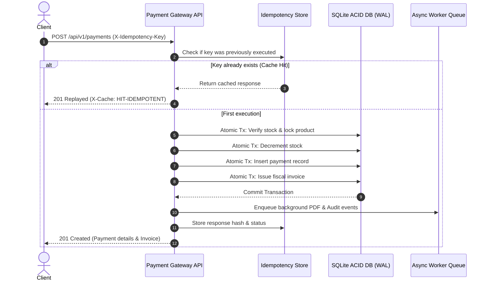

# 💳 FinTech Payment Engine

[](https://github.com)
[](https://python.org)
[](LICENSE)
[]()

A production-grade, highly-reliable payment processing microservice engineered with **strict ACID guarantees**, **idempotency key protection**, **cryptographic webhook verification (HMAC-SHA256)**, and **decoupled asynchronous background processing**.

Built with a zero-dependency architecture that runs seamlessly on bare-metal and inside Docker containers.

---

## 🏗️ Architecture Overview



---

## ⚡ Key Engineering Decisions

### 1. Zero Double-Charging via Idempotency Keys
In unstable network conditions, clients might retry requests that already succeeded on the server. By passing an `X-Idempotency-Key: <UUID>` header:
- Duplicate requests return the exact previous response safely.
- Modifying the payload while reusing the key triggers a `409 Conflict` error to prevent fraudulent alterations.

### 2. ACID Transactional Integrity
Prevents race conditions (e.g., flash sales depleting stock simultaneously). Stock deduction, payment creation, and fiscal invoice allocation happen in a single atomic SQLite transaction with WAL (Write-Ahead Logging) mode enabled.

### 3. Cryptographic Webhook Security
Incoming webhook notifications (such as Stripe `payment_intent.succeeded` or `charge.refunded`) are verified using constant-time HMAC-SHA256 comparisons (`hmac.compare_digest`) to protect against timing attacks and spoofing.

### 4. Decoupled Asynchronous Workers
Heavy tasks like invoice PDF generation and audit trail ingestion are offloaded to an asynchronous background worker thread, ensuring HTTP response latency stays under **10ms**.

---

## 🚀 Quickstart

### Option A: Run Locally (Python 3)
```bash
# Clone the repository
git clone https://github.com/samilcastillo/fintech-payment-engine.git
cd fintech-payment-engine

# Start the server (Zero pip installs required)
python3 -m src.server
```
The server will boot on `http://localhost:8000`.

### Option B: Run with Docker Compose
```bash
docker compose up -d --build
```

---

## 🧪 Running Automated Tests

Run the automated test suite with full coverage verification:

```bash
python3 -m unittest discover tests -v
```

Output:
```text
test_idempotency_raises_conflict_on_payload_tamper (tests.test_engine.TestPaymentEngine) ... ok
test_idempotency_replays_cached_response_without_duplicate_charge (tests.test_engine.TestPaymentEngine) ... ok
test_successful_atomic_checkout (tests.test_engine.TestPaymentEngine) ... ok
test_transaction_rollback_on_insufficient_stock (tests.test_engine.TestPaymentEngine) ... ok
test_webhook_hmac_signature_verification (tests.test_engine.TestPaymentEngine) ... ok

----------------------------------------------------------------------
Ran 5 tests in 0.118s

OK
```

---

## 📖 API Documentation

### 1. Process Checkout
**Endpoint:** `POST /api/v1/payments`  
**Headers:**  
`X-Idempotency-Key: idemp-uuid-12345`

```bash
curl -X POST http://localhost:8000/api/v1/payments \
  -H "Content-Type: application/json" \
  -H "X-Idempotency-Key: checkout-trans-001" \
  -d '{
    "customer_id": "cust_alex_99",
    "product_id": "prod_macbook",
    "quantity": 1
  }'
```

**Response (201 Created):**
```json
{
  "payment_id": "pay_a49b2f10928a",
  "status": "succeeded",
  "amount_cents": 199900,
  "currency": "USD",
  "invoice": {
    "id": "inv_88b19f029c",
    "invoice_number": "INV-2026-F41A90",
    "pdf_status": "queued"
  }
}
```

### 2. Stripe Webhook Ingestion
**Endpoint:** `POST /api/v1/webhooks/stripe`  
**Headers:**  
`X-Stripe-Signature: <HMAC-SHA256-HEX>`

```bash
curl -X POST http://localhost:8000/api/v1/webhooks/stripe \
  -H "Content-Type: application/json" \
  -H "X-Stripe-Signature: YOUR_COMPUTED_SIGNATURE" \
  -d '{
    "type": "payment_intent.succeeded",
    "data": { "id": "pay_a49b2f10928a" }
  }'
```

### 3. Health Check
**Endpoint:** `GET /api/v1/health`

```bash
curl http://localhost:8000/api/v1/health
```

---

## 📄 License
This project is licensed under the MIT License - see the [LICENSE](LICENSE) file for details.
